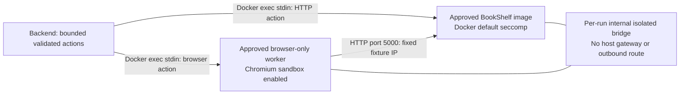

# Isolated Chromium worker

The application and browser run in separate containers. Both approved BookShelf
image IDs and their commit labels remain unchanged. A fixed trusted Python launcher
overrides only Flask's bind address to `0.0.0.0` inside the application container;
it then invokes the existing immutable fixture worker. No downloaded Python runs
on the Mac, and no modified application source is copied into either container.



The browser has its own filesystem/process namespace and no application files,
keys, host mounts, Docker socket, or listening command server. Its only dispatcher
accepts the strict `browser_test` schema from stdin, with a 20 KB input limit and
13-second execution timeout. Chromium stays sandboxed; contexts block downloads,
service workers, non-fixture HTTP requests and all WebSockets. Marker evaluation
code remains fixed. Model HTML is test data executed only in the sandboxed browser.

Both containers use UID/GID 10001, read-only root filesystems, dropped capabilities,
no-new-privileges, one CPU, 768 MiB RAM, 128 PIDs, bounded private `/tmp` and `/dev/shm`,
an init process and 150-second self-expiry. No published ports, bind/volume mounts,
host IPC/PID/network mode, privileged mode or application secrets are supplied.
The application retains Docker's default seccomp policy. Browser startup requires
an approved immutable image, matching runner-content label and seccomp digest.
No automatic image build, pull, approval, or host execution fallback exists in the
backend. After changing browser runner files, Dockerfile or dependency locks, rebuild/review and explicitly update
the private approval; stale approvals fail closed.

The network uses `--internal` and
`com.docker.network.bridge.gateway_mode_ipv4=isolated`. Unlike an ordinary internal
bridge, this does not give the Docker host an interface address on the bridge.
IPv6 is disabled. There is no default route or masquerading. DNS upstream is set
to container loopback so Docker cannot forward external DNS queries. Only the two
run-specific endpoints join this network; the browser receives the application's
numeric private IP, not a model-provided origin. Docker daemon administrators remain
trusted and can change network membership; these controls do not constrain them.

## Seccomp provenance and scope

`docker-default-seccomp.json` is the unmodified official Moby profile at commit
`6fe7deb1b9fb7c0397a4593480d7d22b9ee8caef`:
https://github.com/moby/profiles/blob/6fe7deb1b9fb7c0397a4593480d7d22b9ee8caef/seccomp/default.json

`chromium-seccomp.json` adds only `clone`, `setns`, `unshare` (as recommended by
https://playwright.dev/python/docs/docker) and `chroot`. The additional `chroot`
allowance is needed because dropping every outer capability also makes the default
profile deny it inside Chromium's new user namespace. Kernel capability checks
still deny an ordinary non-root process from chrooting in the outer namespace;
no container capability is added. This is a syscall-scoped allowance, not a
path- or flag-sensitive policy. Seccomp cannot validate the pointed-to chroot path.
All other baseline rules, including default-deny and capability-conditioned rules,
are retained. A regression test checks that exact delta.

Playwright's older bundled profile failed container initialization on Docker 29.0.1;
the current default-derived profile successfully launched sandboxed Chromium under
the required non-root/cap-drop/no-new-privileges constraints. No unconfined policy,
disabled Chromium sandbox, extra capabilities, or host IPC workaround is used.

## Build, review, approve and validate

The Dockerfile pins the official Playwright Python v1.63.0 image by digest. Build
with a minimal context containing only the files in `app.sandbox.BROWSER_FILES`
under `backend/`, and pass the value of `app.sandbox.browser_digest()` as
`BROWSER_WORKER_SHA256`. Inspect the result and record its immutable local image ID,
runner digest and profile digest in ignored `backend/browser/approval.json` using
`approval.example.json`. `BMF_BROWSER_APPROVAL` optionally selects a different
private manifest. Never use a mutable image tag in the approval.

Run from the repository root, with Docker daemon access:

```sh
backend/.venv/bin/python backend/scripts/validate_browser_isolation.py backend/fixture/approvals.json
```

This is a deterministic component check using ordinary review text, no exploit,
model, GitHub ingestion or autonomous workflow. It verifies Chromium launch,
fixture navigation, the bounded authentication/review/revisit flow, both containers'
runtime restrictions, external/metadata/Docker-host connection failures, DNS
blocking and resource cleanup. Sanitized results are written to
`backend/browser/validation-report.json`. `scripts/validate_fixtures.py` forwards to the same current checks for compatibility.
`fixture/validation-report.json` retains the historical single-container results.

Limitations: this shares Docker Desktop's Linux kernel and is not a VM boundary.
Namespace syscalls increase the browser container's kernel attack surface; malicious
pages could exploit a browser/kernel vulnerability. Network probes sample forbidden
destinations rather than proving every possible address unreachable; isolation also
depends on Docker's internal/isolated bridge enforcement and the absence of routes.
Self-expiry stops containers but cannot remove Docker network objects if the host
backend is killed; normal exception/timeout/cancellation cleanup removes them.
The live API remains disabled pending separate provider verification and review.

Verified October 15: **79 backend tests passed** (one existing Starlette/HTTPX
deprecation warning), and **16 Docker component checks passed** across both fixtures,
including direct Chromium denial of external/metadata navigation and forced tool
timeout cleanup. No test containers or temporary networks remained afterward.

Dependency split: `requirements.txt` and `requirements.lock.txt` now pin all eight
browser packages for Python 3.12 with hashes. The Dockerfile enforces hash checks,
and both dependency files are part of the approval digest. See
[dependency environments](../DEPENDENCIES.md). A new browser-only image was built
for this recipe; the previous browser image and both BookShelf images were retained.

After the dependency split, **86 backend tests passed** and all **16 Docker
component checks passed** against the unchanged BookShelf fixtures with the new
hash-locked browser image. Linux ARM64 worker validation and macOS ARM64 backend
validation are covered; other deployment platforms require separate verification.
